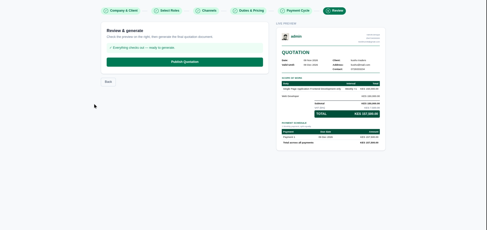
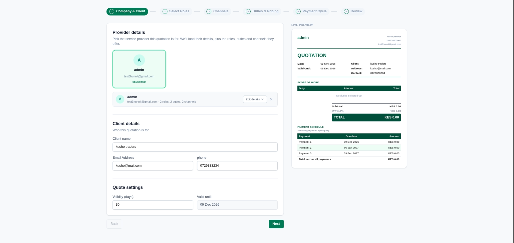
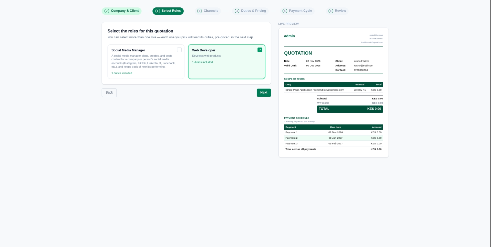
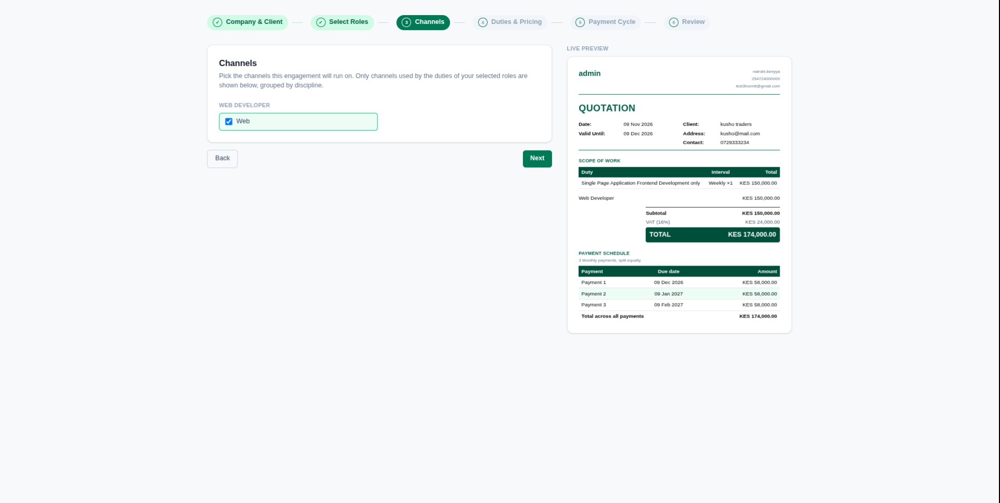
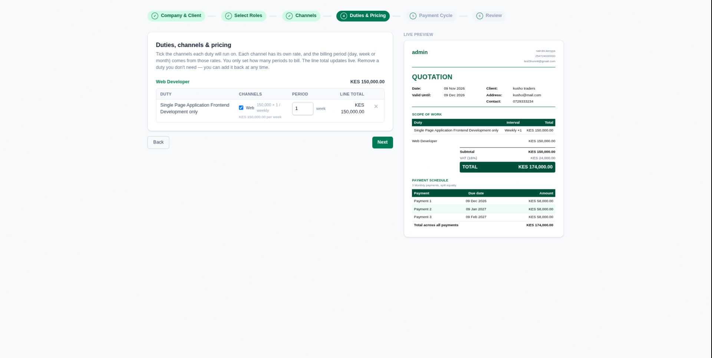
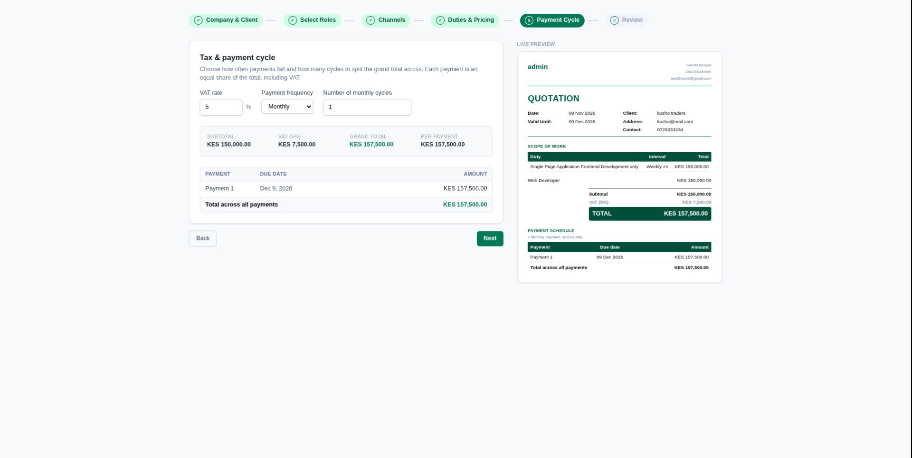

# Quotation Generator

A guided web app for service providers to build professional, branded quotations in minutes. Pick a provider, choose the roles and channels you're quoting for, set pricing and a payment schedule, and watch the quotation take shape in a live preview before publishing it.

## Features

- **Six-step wizard** with a progress tracker: Company & Client → Select Roles → Channels → Duties & Pricing → Payment Cycle → Review.
- **Live preview**: the quotation document updates beside the form as you type, so you always see exactly what the client will receive.
- **Provider profiles**: select a service provider and their details, roles, duties and channels load automatically (name, email, location, phone, logo).
- **Client details**: capture client name, email and phone.
- **Quote validity**: set the validity in days and the "valid until" date is calculated for you.
- **Multi-role quotations**: select one or more roles (e.g. Web Developer, Social Media Manager). Each role loads its own pre-priced duties.
- **Channels**: pick the channels an engagement will run on. Only channels used by the duties of the selected roles are shown, grouped by discipline.
- **Per-channel pricing**: every channel has its own rate and billing period (day, week or month). You only set how many periods to bill, and the line total updates live.
- **Editable scope**: remove duties you don't need and add them back at any time.
- **Configurable VAT**: set the VAT rate per quotation.
- **Payment schedule**: choose the payment frequency and number of cycles; the grand total (including VAT) is split equally into dated payments.
- **Review & publish**: a final check before generating the quotation document.

## Screenshots

| Step | Preview |
| --- | --- |
| 1. Company & Client |  |
| 2. Select Roles |  |
| 3. Channels |  |
| 4. Duties & Pricing |  |
| 5. Payment Cycle |  |
| 6. Review & Publish |  |

## How It Works

1. **Company & Client**: choose the provider, then enter the client's name, email and phone. Set how many days the quote stays valid.
2. **Select Roles**: tick the roles that apply. Each role shows how many duties it includes.
3. **Channels**: tick the channels (for example Web) the engagement will run on.
4. **Duties & Pricing**: for each duty, tick its channels and set the number of billing periods. Rates are pre-filled, and line totals, subtotal and VAT are computed for you.
5. **Payment Cycle**: set the VAT rate, payment frequency and number of cycles. The schedule table shows each due date and amount.
6. **Review**: check the live preview and click **Publish Quotation**.

## Tech Stack

- Frontend: Angular

## Usage

1. Sign in and make sure at least one provider exists with roles, duties and channel rates configured.
2. Start a new quotation and follow the six steps.
3. Publish the quotation to generate the final document.

## Roadmap

- [ ] Integrate KRA eTIMS to issue valid electronic tax invoices (ETR-compliant)
- [ ] Queue that automatically sends invoices when each scheduled payment falls due
- [ ] Automated payment reminders for upcoming and overdue payments

## License

<!-- Add your license, e.g. MIT -->
This project is licensed under the [MIT License](LICENSE).

## Author

**Victor Nyambuti** (Kov): [portfolio](https://victornyambuti.com) <!-- update link -->